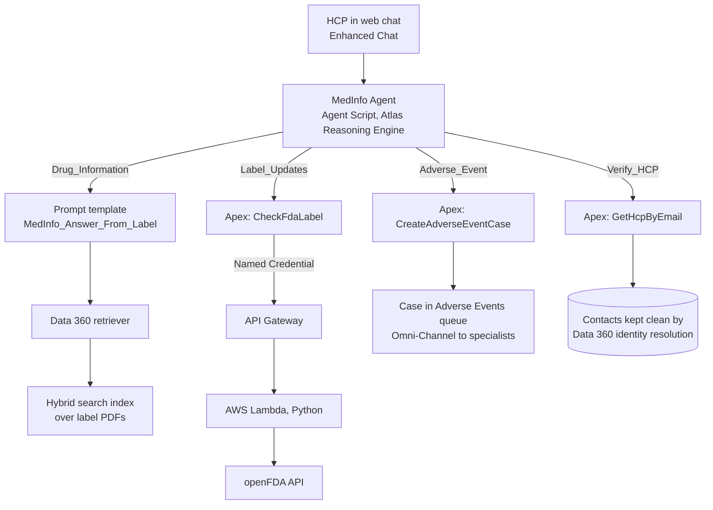

# MedInfo Agent

An Agentforce agent that answers healthcare professionals' (HCPs') drug questions from approved FDA labels, verifies who it's talking to with Data 360, routes every possible adverse event to a human, and checks the latest FDA label through AWS Lambda.

It models a pharma **medical information** desk: answers must come only from approved content, and any report of a side effect must reach pharmacovigilance. All company names and people are fictional; drug content comes from public FDA labels.

## Architecture



## What it demonstrates

| Area | Where |
| --- | --- |
| Agentforce agent written in **Agent Script** (subagents, variables, gated actions) | `agent/MedInfo_Agent.agent` |
| Custom **Apex invocable actions**, bulk-safe, user mode, with unit tests | `force-app/main/default/classes` |
| **Data 360**: data streams, DLO-to-DMO mapping, **identity resolution**, calculated insight, data action | `data360/SETUP.md`, `data/` |
| **Unstructured DMOs, hybrid search index, retriever, RAG** over label PDFs | `data360/SETUP.md` step 6 |
| **AWS Lambda** (Python) behind API Gateway, deployed with AWS SAM, with unit tests | `lambda/` |
| **REST integration** from Apex through a Named Credential | `CheckFdaLabel.cls` |
| **Omni-Channel / Enhanced Chat** escalation path | Adverse Events queue, deployment steps below |
| **CI/CD** with GitHub Actions: Lambda tests, Apex deploy and tests, agent tests | `.github/workflows/ci.yml` |
| Agent **testing** with expected subagents and actions | `agent/tests/MedInfo_Agent_Tests.yaml` |

## Setup

You need a Salesforce Developer Edition org with Agentforce and Data 360 enabled, the Salesforce CLI, an AWS account, and the AWS SAM CLI.

1. **Deploy the Lambda**
   ```bash
   cd lambda
   sam build && sam deploy --guided
   ```
   Note the `ApiBaseUrl` output. Test it: `curl "<ApiBaseUrl>/label?drug=metformin"`.
2. **Create the Named Credential** in Setup: an External Credential with **No Authentication**, and a Named Credential `FDA_Lambda` with URL = `ApiBaseUrl`. Give the agent user's permission set access to the External Credential principal.
3. **Deploy the Salesforce metadata**
   ```bash
   sf org login web --alias medinfo --set-default
   sf project deploy start --source-dir force-app --test-level RunLocalTests
   sf org assign permset --name MedInfo_Agent_Access --on-behalf-of <agent-user-username>
   ```
4. **Configure Data 360** by following `data360/SETUP.md`.
5. **Load the agent** by following `agent/README.md`.
6. **Deploy to a channel**: create a Messaging for In-App and Web (Enhanced Chat) channel, connect the agent, and add an Omni-Channel flow that routes the Adverse Events queue to your specialist presence status.
7. **CI**: add an `SFDX_AUTH_URL` repository secret (`sf org display --verbose` shows it) so GitHub Actions can deploy and run Apex and agent tests.

## Running the tests locally

```bash
python -m unittest discover -s lambda/tests -v      # Lambda: 7 tests
sf apex run test --test-level RunLocalTests --wait 10 # Apex: 9 test methods
sf agent test run --api-name MedInfo_Agent_Tests      # agent routing tests
```

## Security notes

- The API Gateway endpoint is public because openFDA data is public. In production, add IAM or a Lambda authorizer and call it from Salesforce with an authenticated Named Credential.
- Apex actions run in user mode (`WITH USER_MODE`, `insert as user`), so the agent user's permissions and field-level security apply.
- No patient-identifying data is stored; adverse-event text is whatever the HCP chooses to share.

## Results

Fill these in after you run it:

| Metric | Value |
| --- | --- |
| Identity resolution: 50 source profiles unified into | [n] individuals |
| Agent tests passing | [n] / 8 |
| Apex test coverage | [n]% |
| Demo video | [link] |

## Built with

Salesforce Agentforce, Agent Script, Data 360, Apex, AWS Lambda (Python 3.12), API Gateway, AWS SAM, openFDA, GitHub Actions. Built by Abhist Kumar, using Claude Code as an AI coding assistant.
